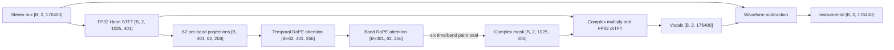

# Exp09 stereo BS-RoFormer-inspired separator

The model was implemented independently in PyTorch from the published band-split, alternating-axis attention, RoPE and complex masking ideas. All trainable tensors, including affine offsets and scales, use seeded random draws. Hann windows and RoPE frequencies are fixed buffers or computed constants. The implementation uses no imported separator code, pretrained checkpoint, teacher signal, distillation or pseudo-labels. [Lu et al., BS-RoFormer](https://arxiv.org/html/2309.02612v2) · [Su et al., RoFormer](https://arxiv.org/abs/2104.09864)

## Tensor contract and parameter count

| Stage | Tensor and operation |
|---|---|
| Input | Float waveform `[B, 2, 176400]`, channels left and right, 44.1 kHz |
| Analysis | Centered Hann STFT, FFT/window 2,048, hop 441. FP32 input and complex64 spectrum `[B, 2, 1025, 401]` |
| Bands | 24×2, 12×4, 8×12, 8×24, 8×48, 128, 129 bins. Contiguous, nonoverlapping and cover DC through Nyquist |
| Band projection | `[B, 401, 1025, 4]`, with per-bin order L real, L imaginary, R real, R imaginary. Apply asinh, flatten each band's `4 × bins` values and linearly project to 256. Stack to `[B, 401, 62, 256]` |
| Temporal attention | Flatten batch and bands to `[B×62, 401, 256]`. Q, K and V each `[B×62, 8, 401, 32]`. Apply RoPE to 16 adjacent feature pairs per head in Q and K, then bidirectional scaled dot-product attention |
| Frequency attention | Flatten batch and frames to `[B×401, 62, 256]`. Q, K and V each `[B×401, 8, 62, 32]`. Apply the same RoPE rule to ordered band indices |
| Each block | LayerNorm → attention + residual, LayerNorm → linear 256→1,024 → GELU → linear 1,024→256 + residual. Six temporal/frequency pairs, 12 distinct blocks |
| Mask | Shared LayerNorm, linear 256→256 and GELU, followed by 62 band-specific linear readouts. Pack `[B, 401, 1025, 2, 2]` into `[B, 2, 1025, 401]` complex64. Map each raw complex pair `r` to `2r / sqrt(16 + abs(r)^2)`, a smooth magnitude bound of 2 |
| Synthesis | Mask × input spectrum, then iSTFT to original sample count. Instrumental is the input waveform minus estimated vocals. Both are FP32 and mixture-consistent up to float rounding |

| Trainable component | Parameters |
|---|---:|
| 62 input projections | 1,065,472 |
| 12 attention blocks, 789,760 each | 9,477,120 |
| Shared mask features | 66,304 |
| 62 mask readouts | 1,053,700 |
| **Total** | **11,662,596** |

The input normalization, width, depth, shared decoder and radial cap are Exp09 implementation choices. A bounded mask limits amplification and can underrepresent targets in mixture bins with strong destructive cancellation. Track that behavior in later development. Training uses BF16 autocast for the learned path and FP32 for STFT, iSTFT, complex mask math, waveform outputs, losses, and AdamW state. Spectral loss uses constant boundary padding for strict deterministic CUDA backward. Optimizer-step activation checkpointing recomputes the same 12 blocks and preserves capacity.

The complementary instrumental waveform makes the signed instrumental error the negative of the vocal error for aligned additive targets. Applying the same waveform or linear-STFT residual objective twice would duplicate its contribution. The implemented loss uses vocal L1 plus the mean complex residual magnitude from unitary FFTs at 512, 1,024 and 2,048 samples with quarter-window hops. Both stems still get reported SDR.
